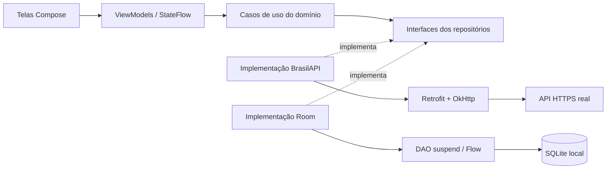

# EntregaFácil

Aplicação acadêmica Android para acompanhar pacotes, destinatários e destinos. Permite cadastrar, pesquisar, filtrar, editar, alterar o status e excluir entregas por **soft delete**. A interface está em português do Brasil, com Material 3 e cores próprias em verde e âmbar.

## Executar no Android Studio

1. Abra esta pasta no Android Studio compatível com AGP 9.4.1 (o projeto foi criado no Android Studio 2026.1.4).
2. Instale o SDK **Android API 37** pelo SDK Manager. O Gradle usa `compileSdk` e `targetSdk` 37; o aplicativo funciona a partir do Android 7.0 / API 24.
3. Aguarde a sincronização do Gradle e o download das dependências. O wrapper inclui Gradle **9.6.0** e os critérios de JVM em `gradle/gradle-daemon-jvm.properties` solicitam **JDK 25**, provisionado automaticamente pelo Foojay. Para iniciar o wrapper pela linha de comando, tenha um JDK válido disponível em `JAVA_HOME` (JDK 17 ou superior).
4. Crie um emulador ou conecte um aparelho com depuração USB. Selecione a configuração **app** e clique em **Run**.
5. Conceder uma permissão na tela não é necessário: `INTERNET` é uma permissão normal declarada no manifesto. Para consultar CEP, o aparelho/emulador precisa de internet.

`local.properties` contém somente o caminho local do SDK e não deve ser compartilhado. O Android Studio pode gerá-lo em outra máquina. O projeto não precisa de chave de API, backend próprio ou serviço de nuvem.

### Compilar e verificar

No PowerShell, dentro da raiz do projeto:

```powershell
.\gradlew.bat :app:assembleDebug :app:testDebugUnitTest :app:lintDebug
.\gradlew.bat :app:assembleRelease :app:assembleDebugAndroidTest
```

Se aparecer `JAVA_HOME is set to an invalid directory`, configure a variável **da sessão** para a pasta de um JDK instalado. Nesta máquina, foi usado:

```powershell
$env:JAVA_HOME = 'C:\Program Files\Eclipse Adoptium\jdk-17.0.19.10-hotspot'
.\gradlew.bat :app:assembleDebug :app:testDebugUnitTest :app:lintDebug
```

O daemon continua usando o JDK 25 solicitado pelo projeto. Não aponte `JAVA_HOME` para um instalador `.exe`.

O APK instalável de depuração fica em `app/build/outputs/apk/debug/app-debug.apk`. O APK release é **não assinado**; para distribuição, gere uma assinatura pelo Android Studio. Os testes que precisam de um dispositivo são executados com:

```powershell
.\gradlew.bat :app:connectedDebugAndroidTest
```

Veja [Validação](docs/VALIDACAO.md) para os resultados efetivamente obtidos e suas limitações.

## Estrutura e dependências

O [inventário completo de arquivos](docs/ESTRUTURA.md) informa os caminhos de todo o código. Todos os arquivos estão implementados no projeto, incluindo os processamentos de rede e banco; classes geradas de Hilt e Room são produzidas pelo KSP durante a compilação.

```text
app/src/main/java/com/example/appentregafacil/
├── MainActivity.kt                 # Activity com @AndroidEntryPoint
├── EntregaFacilApplication.kt      # Application com @HiltAndroidApp
├── domain/
│   ├── model/                     # Delivery, Address, Draft, status e validações
│   ├── repository/                # Contratos de entregas e endereços
│   └── usecase/                   # Consultar, observar, salvar, alterar e excluir
├── data/
│   ├── remote/                    # DTO e serviço Retrofit da BrasilAPI
│   ├── local/                     # Entity, DAO, converters e RoomDatabase
│   ├── mapper/                    # Conversão DTO/Entity para domínio
│   └── repository/                # Implementações de rede e persistência
├── di/                            # Módulo Hilt e criação dos casos de uso
├── presentation/
│   ├── navigation/                # NavHost e argumentos de identificação
│   ├── list/                      # Tela, estado e ViewModel de listagem
│   ├── form/                      # Formulário e ViewModel de cadastro/edição
│   ├── detail/                    # Tela, estado e ViewModel de detalhes
│   └── common/                    # Componentes e mensagens em português
└── ui/theme/                      # Tema Material 3 e tipografia
```

As versões são fixadas em `gradle/libs.versions.toml`:

| Componente | Versão |
| --- | --- |
| Android Gradle Plugin / Gradle wrapper | 9.4.1 / 9.6.0 |
| Plugin Kotlin Compose | 2.2.10 |
| KSP / Hilt | 2.3.13 / 2.60.1 |
| Compose BOM / Material 3 | 2026.02.01 / definido pelo BOM |
| Lifecycle / Activity Compose | 2.11.0 / 1.13.0 |
| Navigation Compose / Hilt ViewModel Compose | 2.9.5 / 1.3.0 |
| Room | 2.8.5 |
| Retrofit / Gson converter | 3.0.0 |
| OkHttp / logging-interceptor | 4.12.0 |
| Coroutines | 1.10.2 |
| Desugaring de java.time | 2.1.5 |

O AGP 9 fornece suporte Kotlin integrado; por isso o projeto não aplica `org.jetbrains.kotlin.android`. KSP gera os adaptadores de Room e a injeção de Hilt. Java 17 é a versão alvo do bytecode; `coreLibraryDesugaring` disponibiliza `java.time.Instant` no Android 24 e 25.

## Arquitetura e fluxo do cadastro

O domínio utiliza Kotlin, `java.time` e `Flow` de Coroutines. Não importa Android, Compose, Retrofit, Room ou Hilt. Seus casos de uso recebem interfaces pelo construtor. O módulo `di/AppModule.kt` monta essas dependências, preservando a independência do domínio.



1. Ao tocar em **Consultar CEP**, `DeliveryFormViewModel` valida o formato e impede uma segunda consulta enquanto a primeira estiver em andamento. São aceitos `01001000` e `01001-000`.
2. `LookupPostalCode` normaliza o CEP e chama a interface `AddressRepository`. A implementação `BrasilApiAddressRepository` faz uma requisição real por Retrofit e OkHttp para `GET https://brasilapi.com.br/api/cep/v1/{cep}`.
3. O DTO é validado e convertido para `Address`. A tela preenche rua, bairro, cidade e UF. Número e complemento permanecem manuais. CEPs gerais podem não retornar rua/bairro; esses campos permanecem editáveis e obrigatórios antes de salvar.
4. O ViewModel registra qual CEP foi consultado com sucesso. Alterar seus dígitos invalida essa confirmação, inclusive ao voltar depois ao CEP anterior. Alterar apenas a máscara do mesmo CEP não invalida a consulta. Um novo cadastro não pode ser salvo antes da consulta bem-sucedida. Um registro existente pode ser editado sem rede enquanto seu CEP continuar igual.
5. **Salvar entrega** chama `SaveDelivery`, que repete as validações, normaliza os dados e cria ou atualiza o registro pelo repositório local. Uma edição preserva `id` e `createdAt`; `updatedAt` recebe o instante da operação.
6. O DAO de Room grava no SQLite de forma assíncrona. Os fluxos observados por `StateFlow` e `collectAsStateWithLifecycle` atualizam listagem e detalhes após a gravação. Nenhuma chamada de rede ou SQL bloqueante é feita na thread da interface.

Consulta de CEP e salvamento são operações separadas: **a BrasilAPI fornece o endereço; Room armazena a entrega inteira**. A consulta não cria uma entrega automaticamente. Não há sincronização remota das entregas.

Os rascunhos, a confirmação do CEP, a pesquisa e o filtro usam `SavedStateHandle`; os dados preenchidos são mantidos em erros e em recriações da tela pelo sistema. Estados transitórios de carregamento e os resultados de navegação são expostos por `StateFlow`.

## Persistência e soft delete

O banco `entregafacil.db`, versão 1, tem uma tabela `deliveries`. O modelo contém todos os campos solicitados: `id`, `recipientName`, `packageDescription`, `postalCode`, `street`, `number`, `complement`, `neighborhood`, `city`, `state`, `status`, `createdAt`, `updatedAt` e `deletedAt`.

- `id`: `Long` autogerado.
- `status`: enum `DeliveryStatus`, persistido como `PENDING`, `IN_TRANSIT` ou `DELIVERED` e exibido em português.
- Datas: `Instant` em UTC no domínio, convertido em milissegundos desde epoch no SQLite e exibido no fuso do aparelho.
- `deletedAt`: `null` para registros ativos. Ao confirmar a exclusão, recebe a data atual e o registro permanece no banco.

Todas as consultas normais do DAO incluem `WHERE deletedAt IS NULL`, inclusive a consulta por identificador. Edição e alteração de status também usam essa condição para impedir a reativação acidental de um registro excluído. Não existe comando `DELETE` no DAO. O schema exportado está em `app/schemas/`.

A pesquisa por destinatário ignora diferenças de maiúsculas/minúsculas e pode ser combinada com o status. Para manter o exemplo acadêmico simples, o repositório observa os registros ativos de Room e o caso de uso filtra a lista em memória; para grandes volumes, paginação e filtragem no SQL seriam uma evolução.

## Falhas e uso sem internet

Há mensagens específicas para CEP inválido, não encontrado, falta de conexão, timeout, servidor indisponível e resposta inválida. É possível repetir a consulta com o botão **Consultar CEP**. Os campos não são apagados em caso de falha. Cancelamentos de Coroutines são propagados.

OkHttp tem timeout de conexão de 10 segundos, leitura e escrita de 15 segundos e prazo total de 25 segundos. O interceptor de logs é adicionado apenas quando `BuildConfig.DEBUG` é verdadeiro, no nível `BASIC`, sem registrar o corpo das respostas.

Sem internet, a listagem, a pesquisa, os detalhes, a edição com CEP inalterado, a alteração de status e a exclusão continuam utilizando Room. A consulta de um CEP novo precisa de conexão. O estado vazio do aplicativo é real: nenhuma entrega de demonstração é inserida automaticamente.

## Material para apresentação

- [Roteiro de demonstração em aula](docs/ROTEIRO_DEMONSTRACAO.md)
- [Checklist de exigências e arquivos responsáveis](docs/CHECKLIST.md)
- [Contrato da BrasilAPI verificado antes da implementação](docs/BRASILAPI.md)
- [Estrutura completa de arquivos](docs/ESTRUTURA.md)
- [Resultados de compilação e testes](docs/VALIDACAO.md)

As respostas simuladas existem somente em `app/src/test/`, para testes determinísticos de erros HTTP. A aplicação de produção sempre utiliza o serviço HTTPS real configurado em `AppModule`.
